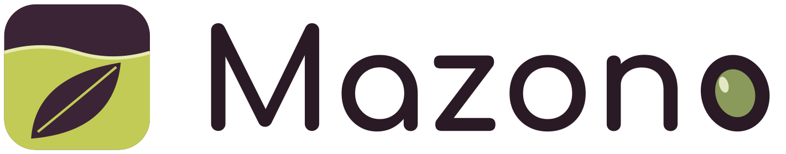

<p align="center"></p>

# Mazono

> **Harvesting olives is hard work. Managing your grove shouldn't be.**

Named after *μαζώνω* (ma-ZO-no), the word olive growers on the Greek island of Crete have used
for generations for harvesting their olives (see [the brand guide](docs/BRAND.md)).

Open-source, self-hosted app for olive growers: log field work in seconds, follow olive oil
production season by season, and compare fields and years.

Available in **English** and **Ελληνικά**. Works offline on your phone as an installable web app (PWA).

## What it does

Work is grouped by **farming year**: from the spring work (1 March) to the end of the harvest and
the last mill visit (February), named by its year. Money is counted per calendar year.

### Field work

- **Quick setup**: language, collection units (sack, half sack, crate, pallet bin… or your own,
  with an optional approximate weight) and your fields with tree counts, in the order you usually
  work them.
- **Today screen**: the task for the season is preselected (harvest, pruning, fertilizer,
  weed whacking, or your own task types), and so is the field you worked last while it still has
  trees left. Each field shows how many trees are left; finished fields go to the end.
- **Harvest**: trees harvested and the units collected (mix several units, half steps). After saving
  you see units per tree for the day and the year's yield per tree. Entering trees is optional.
- **Field order**: set your own order in Settings, or let the app learn it for each task from the
  order you worked the fields in earlier years.
- **Journal**: day by day, with a month calendar showing a coloured dot for each task type.
  Tap an entry to change it; delete with undo.
- Swipe dates, months and years to step through them, and swipe between pages.

### Mill and oil

- **Mill visits**: olives and oil kg with live yield (1/4.3 or %), acidity, receipt number and mill.
- **Charges kept in oil** (mill fee, bug spraying, VAT, or your own), each shown as % of the oil and
  filled in from your usual % if you set one. The net delivered oil is calculated for you.
- **Where the oil went**: split it between the mill, home or your own places.
- **Harvest days → mill visit**: tick the harvest days whose olives went to the mill (pre-ticked since
  the last visit), or only part of a day. Oil is shared between fields in proportion to the olives,
  and the weight of each unit (e.g. per sack) is learned from your visits.
- **Oil page**: year totals, every mill visit, oil per field and per tree, and **oil in stock**
  by year and place, with transfers (mill → home) and own use / gifts.

### Money

- **Expenses** with business name (remembered, with its category), amount, category and invoice no.
- **Oil sales**: buyer, kg and € per kg → total, with an optional fee (% or €, remembered per buyer).
  The oil is taken out of stock, by default from the oldest year at the mill, and you cannot sell
  more than you have.
- **Other income** such as subsidies (ΟΠΕΚΕΠΕ) or VAT refunds.
- **Totals** by calendar year: oil sales (kg and average price), other income, expenses,
  net result, an optional tax estimate, and the value of the oil still in stock.

### Reports

- **This year**: the year so far, including the olive oil still to come from olives not yet
  taken to the mill.
- **Fields by year**: olives, oil, per tree or yield for every field and year, shaded so good and
  poor years stand out (yield is compared with usual olive oil yields).
- **Years side by side**: olives, oil, net oil or yield per year as a bar chart and a table.
- **Yield through the year**: the yield of each mill visit by date, for up to three years, to help
  decide when to harvest.
- **Records**: all-time bests, milestone badges with progress, and lifetime totals.
- **Cost of your oil**: income, expenses and net result set against the oil of the same year,
  giving the cost per kg and the break-even price.
- **CSV export** of every report, ready for Excel (Greek or English number style).

### People, sync and backups

- Run the server once (Docker) and every phone or computer signs in to the same data. The **first
  account** is the administrator.
- Phones keep working **without signal**; changes are sent when they are back online and reach the
  other devices within a minute (or with "Sync now" in Settings). If two phones change the same
  record, the newer change wins.
- Administrators add people with a temporary password and choose what each may **see** or
  **change** (Work, Oil, Money, Reports, Settings), or pick **Worker**, **Family** or **Accountant**.
  The server checks every change, and data someone may not see never reaches their phone.
- The Journal shows **who logged** each entry; what someone logged stays when they are removed.
- One installation can hold more than one grove. The owner sees every account on the server
  (without other people's data).
- Stay signed in for 90 days, and see or sign out your **signed-in devices** in Settings.
  Wrong passwords are slowed down, and passwords that are easy to guess are turned down.
- The server keeps **14 daily backups** of its database, and any phone can save or restore a
  backup file (Settings → Data).

## Run it

### With Docker (home lab or server)

```bash
git clone https://github.com/amaninakis/mazono.git
cd mazono
docker compose up -d --build
```

The app is now on port **8080**. Run `docker compose logs mazono` to see the **setup code**:
open the app, enter the code and create the administrator account. The code is only needed
this once and only works until the administrator exists. To use another port, or to have the
log show your own address, set `MAZONO_PORT` or `MAZONO_URL` in a `.env` file (see
`docker-compose.yml`). Browsers only
allow offline mode, "Install app" and secure sign-in over HTTPS, so:

- **Home lab with Tailscale** (nothing opened to the internet):
  `tailscale serve --bg 8080` → open `https://<machine-name>.<tailnet>.ts.net` on your phone.
- **Public server with a domain**: point the domain's DNS to the server, then
  `SITE_ADDRESS=harvest.example.com docker compose --profile https up -d --build`.
  Caddy runs in front and gets an HTTPS certificate automatically.

Data lives in the `mazono_data` Docker volume (`/data` in the container): the database
`mazono.db` and the last 14 daily copies in `backups/`. To back up elsewhere, copy the newest
file from `backups/`. Never run `docker compose down -v`: `-v` deletes the data volume.

**Using it on one phone first?** If you used the app on its own before setting up the server, open
it on that phone after `docker compose up -d --build`: it asks you to create the administrator
account, then uploads everything the phone holds.

Hardware needs are tiny: any Raspberry Pi 3/4/5, NAS or the smallest VPS is enough.

### For development

```bash
cd app
npm install
npm run server   # the sync server on port 8787 (data in app/data)
npm run dev      # http://localhost:5173 (talks to the server above, or works on its own)
npm run lint     # ESLint + Prettier (@maninak/eslint-config), must be clean
npm test         # unit tests
npm run build    # production build in app/dist
```

## Design and contributing

- [docs/DESIGN.md](docs/DESIGN.md) — what the app should become, the data model, every screen,
  decisions taken and the roadmap. Start here before proposing a feature.
- [CONTRIBUTING.md](CONTRIBUTING.md) — how to prepare a pull request.

## Project layout

```
app/                 the web app (Vue 3 + TypeScript + Vite)
  src/core/          business logic, no UI (seasons, field progress, defaults) + tests
  src/db/            local database (Dexie / IndexedDB), multi-farm from the start
  src/i18n/locales/  translation files (en.json, el.json)
  src/screens/       Setup, Today, Journal, Settings (Vue single-file components)
  src/ui/            shared components (Stepper, Toggle, Modal, Toast) and farm state
  src/sync/          sign-in and sync with the server (api, sync engine, account state)
app/server/          the server: Fastify + SQLite (Node's built-in), accounts, sync, backups
deploy/Caddyfile     optional HTTPS front for a public server (docker compose --profile https)
```

## Translating

1. Copy `app/src/i18n/locales/en.json` to `app/src/i18n/locales/<code>.json` (e.g. `de.json`).
2. Translate the values (keep the keys and the `{{placeholders}}`).
3. Register the language in `app/src/i18n/index.ts`.

A test checks that every language has the same keys as English.

## Roadmap

Next: Android/iOS apps (Capacitor), daily reminders, location-aware default field, equipment log,
tasks per tree (numbered or NFC-tagged trees), weather, labour reports and spreadsheet import.
See [docs/DESIGN.md](docs/DESIGN.md) for details.

## Licence

Copyright (C) 2026 Andreas Maninakis.

Mazono is free software: you can use, change and share it under the
[GNU Affero General Public License, version 3 or later](LICENSE) (AGPL-3.0-or-later).
If you run a changed version for other people, for example on a public server, you must offer them
its source code under the same licence.

- **Name and logo:** "Mazono" and its logo are not covered by the AGPL; see
  [TRADEMARKS.md](TRADEMARKS.md). You may run your own unchanged copy under the name, and say that
  your work is based on Mazono. A changed version (fork) must be published under its own name and
  logo. Ask first before offering Mazono as a service to others under its name.
- **Contributing:** contributors accept the [Contributor Licence Agreement](CLA.md) once, in their
  first pull request. You keep the copyright in your work; the CLA lets the project also offer
  commercial plans and app-store releases.
- **Earlier versions:** versions up to 0.12.0 were MIT-licensed. Copies of those versions stay under
  MIT; everything after them is AGPL-3.0-or-later.
