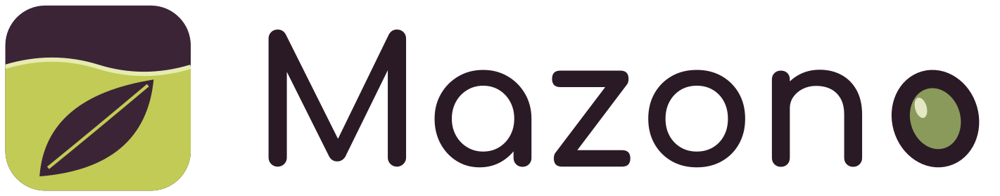
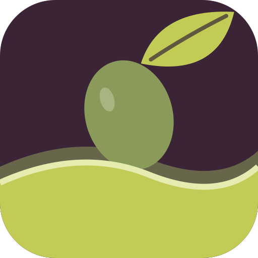

<p align="center"></p>

# Mazono — Brand guide

How Mazono looks and sounds, and how to use its logo, colours and words. The files are in
[`brand/`](../brand), drawn by [`brand/build.py`](../brand/build.py), so they stay in step
with each other and with this guide.

## The name

**Mazono** comes from the Greek verb *μαζώνω* (ma-ZO-no), "to gather, to collect". On Crete,
where much of Greece's olive oil is produced, it is the word for harvesting the olive trees,
the same root as *λιομάζωμα*, the olive harvest.

- Written **mazono** in the logo (lowercase) and **Mazono** in sentences. The same Latin
  spelling in every language, so the icon, the website and word of mouth all match.
- Pronounced **ma-ZO-no**, stress on the middle syllable.
- Formerly HarvestLog. Internal names (the database, saved settings, backups' format, the
  Docker service and volume) keep that first name, so existing installs lose nothing.

**Story (About screen)**

- English: *Named after μαζώνω (ma-ZO-no), the word olive growers on the Greek island of
  Crete have used for generations for harvesting their olives.*
- Ελληνικά: *Πήρε το όνομά του από το «μαζώνω», τη λέξη που χρησιμοποιούν εδώ και γενιές οι
  ελαιοπαραγωγοί της Κρήτης για το μάζεμα των ελιών.*

## Lines

| Use | English | Ελληνικά |
|---|---|---|
| Tagline (website, store page, welcome screen) | Harvesting olives is hard work. Managing your grove shouldn't be. | Το μάζεμα των ελιών είναι σκληρή δουλειά. Η διαχείριση του ελαιώνα σας δεν χρειάζεται να είναι. |
| Short line (under the logo) | — (use the tagline) | Η ελαιοσυγκομιδή, οργανωμένη. |

Store subtitles are short (30 characters on the App Store): use the short line, or the name
alone.

## Voice

The app's voice, unchanged (see [DESIGN.md](DESIGN.md)): plain words in the grower's
language, warm and practical, no technical terms. Greek first.

- Say **ελαιόλαδο** / **olive oil**; ελιές always in the plural (or *καρπός*).
- Honest about the work: the harvest is hard, the app should not add to it.

## Logo

<p> &nbsp; </p>

**Icon.** An olive-oil drop whose shine is an olive leaf, on the Mediterranean sky: from the
trees to the olive oil. There is deliberately nothing inside the drop (a dark round centre
reads as an avocado stone).

**Wordmark.** *mazono* in Comfortaa Bold, turned into outlines (no font needed), with both
o's drawn as olives in **Grove** green. The rounded letters keep it warm and away from the
look of big online shops.

| File | Use |
|---|---|
| `brand/icon.svg` | The app icon, rounded. |
| `brand/icon-full.svg` | Full-bleed square, for phones that cut their own shape (Android "maskable", Apple). The drop stays inside the safe circle. |
| `brand/favicon.svg` | 16–32 px: a fuller drop, no leaf vein. |
| `brand/icon-monochrome.svg` | One colour on transparent (print, stamps, Android themed icons). |
| `brand/wordmark.svg` / `wordmark-light.svg` | Dark letters for light backgrounds / light letters for dark ones. |
| `brand/logo.svg` / `logo-light.svg` | Icon and wordmark side by side. |
| `brand/png/` | PNG exports (1024, 512, 192, 32, 16). |

**Using the logo**

- Leave space around it at least as wide as the olive.
- Smallest sizes: icon 16 px (use the favicon version below 48 px); wordmark 14 px tall.
- Don't recolour the olives, stretch, rotate, outline or add shadows. Don't put the full-colour
  icon on busy photos; use the one-colour version there.
- On the sky colour, use `wordmark-light.svg`.

## Colours

| Name | Hex | Role |
|---|---|---|
| **Sky** | `#2A6699` | The brand colour: icon, start-up screen, website, store. Sparingly inside the app. |
| **Olive oil** | `#C2CB55` | Accent: the drop, small highlights, progress. |
| **Grove** | `#8A9A5B` | The wordmark's olives; secondary colour for charts and illustrations. |
| **Canvas** | `#D9C9A3` | The sack cloth: warm backgrounds, texture, print. |
| **Deep olive** | `#2B3317` | Text and dark marks. |

Inside the app the screens stay **olive**, as before (`--olive` and friends in
`app/src/styles.css`), with a small logo at the top. The sky is for the icon, the start-up
screen, the website and the store.

**Contrast** (checked; aim for 4.5:1 for text, 3:1 for graphics)

| Pair | Ratio | |
|---|---|---|
| White on Sky | 6.1:1 | ✓ text |
| Olive oil drop on Sky | 3.5:1 | ✓ graphic |
| Deep olive on Olive oil | 6.8:1 | ✓ text |
| Deep olive on Canvas | 8.1:1 | ✓ text |
| White on Olive oil | 1.9:1 | ✗ never |
| Deep olive on Sky | 2.4:1 | ✗ never |

## Type

- **Wordmark:** Comfortaa Bold (SIL Open Font License), outlined. Not used for running text.
- **Display** (website headings, posters): Comfortaa Bold; it has Greek, e.g. *Η ελαιοσυγκομιδή,
  οργανωμένη.*
- **App and body text:** the phone's own font (fast, offline, readable in the sun).

## Texture

The canvas of the olive sacks: a fine woven pattern in Canvas tones, for the website and print.
Never behind small text, never on the icon.

## Rebuilding the files

```sh
npm pack @fontsource/comfortaa@5 && tar xzf fontsource-comfortaa-*.tgz
python3 brand/build.py package/files/comfortaa-latin-700-normal.woff2
```

Needs Python 3 with `fonttools` and `brotli`, and `rsvg-convert`. It writes `brand/` and the
icons the app serves in `app/public/`.
